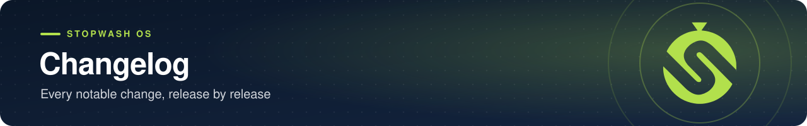

 

<strong>Every notable change to this project, newest first.</strong>

---

> [!NOTE]
> The format follows [Keep a Changelog](https://keepachangelog.com/en/1.1.0/) and the project uses [Semantic Versioning](https://semver.org/spec/v2.0.0.html). Each version links to its full comparison at the bottom of this page, and to its [release notes](https://github.com/saadmaz/Stopwash-POS/releases).

## [Unreleased]

## [0.2.3] - 2026-11-18

### Changed

- Dependency and CI updates: @types/node 26, actions/checkout, setup-node and upload-artifact v7, pnpm/action-setup v6.

## [0.2.2] - 2026-11-17

### Changed

- Contributing, Security Policy, Code of Conduct, License and Changelog redesigned with branded headers, navigation, tables, diagrams and callouts; the licence is now LICENSE.md.

## [0.2.1] - 2026-11-17

### Changed

- Redesigned README with a brand banner, live release, CI and deployment badges, action buttons, feature grid, diagrams and collapsible panels.
- Navigation bars and callouts across the contributing, security, conduct and documentation pages.

## [0.2.0] - 2026-11-17

### Added

- Development and production environments: `develop` deploys to development and `main` to production, through one Deploy workflow and GitHub Environments with per-environment settings.
- API container image published to GitHub Packages for each environment.

## [0.1.0] - 2026-11-16

First pre-production release. Feature-complete on the in-memory backend; production requires the Firebase integration listed under [Owner actions](docs/PROGRESS.md#owner-actions).

### Added

- **Counter:** New Order with live server-side pricing, plate and customer typeahead, and a loyalty indicator.
- **Queue:** status flow, edits, cancellations and refunds, plus the wall TV board (`/tv`) and customer display (`/display`).
- **Checkout:** cash, card and split payments, discounts with manager override, loyalty redemption, receipts and PDFs.
- **Shifts and cash:** opening checklist and cash count, cash-outs with approvals, close and reconciliation with handover, and shift history with corrections.
- **Accounts:** approvals and queries, B2B invoices with settlements, voids and PDF.
- **People:** staff, per-employee PINs on registered devices, attendance and leave, incentive rules, deductions, bonuses and payroll runs with salary slips.
- **Reporting:** daily reports, CSV and revenue PDF exports, and an owner dashboard with sales, retention and an hourly heatmap.
- **Settings:** business profile, loyalty, pricing, thresholds, receipt footer, payroll rules and alert numbers.
- Vehicle history, live manager alerts and an offline order outbox.
- English, Sinhala and Tamil throughout.
- Fastify API enforcing all pricing, money and permission rules, with integer-cent money, Asia/Colombo business days, idempotent writes, append-only financial records and an audit log.
- Multi-stage, non-root API container with a `/health` check.
- Firestore and Storage deny-all baseline rules and emulator configuration.
- Design system and screen designs in Figma.
- Continuous integration on every push and pull request: type check, lint, formatting, unit and API tests, build, Playwright end-to-end shift day and container smoke test.
- Project governance: proprietary licence, security policy, contribution guidelines, code of conduct, issue forms, pull request template, CODEOWNERS and Dependabot.
- Standard documentation layout shared by every STTPS repository: architecture, configuration, deployment, decision records (ADRs) and release and rollback runbooks, indexed in `docs/README.md`.

[Unreleased]: https://github.com/saadmaz/Stopwash-POS/compare/v0.2.3...HEAD
[0.2.3]: https://github.com/saadmaz/Stopwash-POS/compare/v0.2.2...v0.2.3
[0.2.2]: https://github.com/saadmaz/Stopwash-POS/compare/v0.2.1...v0.2.2
[0.2.1]: https://github.com/saadmaz/Stopwash-POS/compare/v0.2.0...v0.2.1
[0.2.0]: https://github.com/saadmaz/Stopwash-POS/compare/v0.1.0...v0.2.0
[0.1.0]: https://github.com/saadmaz/Stopwash-POS/releases/tag/v0.1.0
