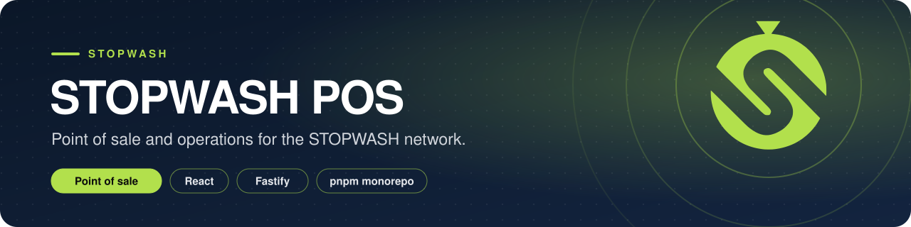
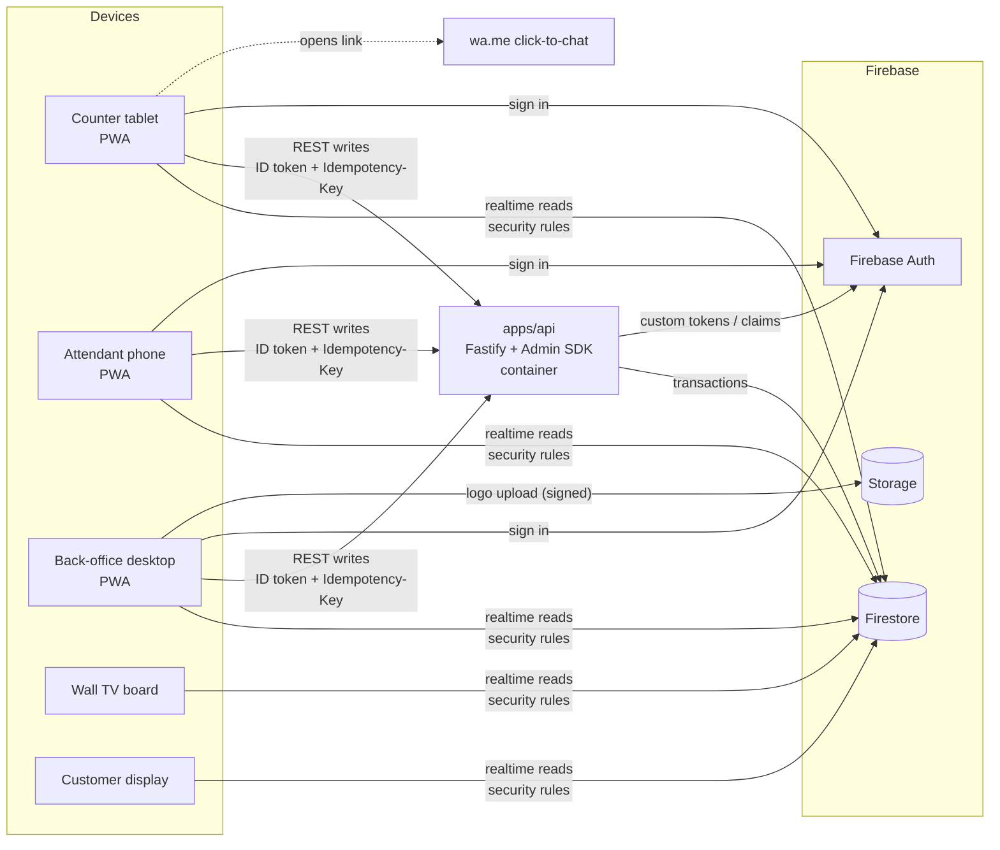
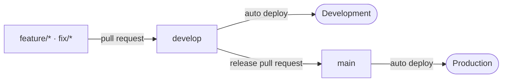

<a id="readme-top"></a>

<div align="center">



<br/>

<p><strong>Counter orders, the live queue, checkout, shifts and cash reconciliation, staff and payroll, reports and loyalty, in English, Sinhala and Tamil.</strong></p>

<a href="https://github.com/saadmaz/Stopwash-POS/releases"></a>
<a href="https://github.com/saadmaz/Stopwash-POS/actions/workflows/ci.yml"></a>
<a href="https://github.com/saadmaz/Stopwash-POS/deployments"></a>
<a href="https://github.com/saadmaz/Stopwash-POS/commits/develop"></a>


<br/>

<a href="https://github.com/saadmaz/Stopwash-POS/pkgs/container/stopwash-pos-api"></a>
<a href="docs/README.md"></a>
<a href="https://github.com/saadmaz/Stopwash-POS/issues/new?template=bug_report.yml"></a>
<a href="https://github.com/saadmaz/Stopwash-POS/issues/new?template=feature_request.yml"></a>

<br/>

<a href="#about">About</a> ·
<a href="#features">Features</a> ·
<a href="#architecture">Architecture</a> ·
<a href="#getting-started">Getting started</a> ·
<a href="#deployment">Deployment</a> ·
<a href="#documentation">Documentation</a> ·
<a href="#contributing">Contributing</a>

</div>

---

<details>
<summary><strong>Table of contents</strong></summary>

1. [About](#about)
2. [Features](#features)
3. [Architecture](#architecture)
4. [Tech stack](#tech-stack)
5. [Getting started](#getting-started)
6. [Configuration](#configuration)
7. [Project structure](#project-structure)
8. [Quality checks](#quality-checks)
9. [Deployment](#deployment)
10. [Documentation](#documentation)
11. [Releases and versioning](#releases-and-versioning)
12. [Contributing](#contributing)
13. [Security](#security)
14. [License](#license)

</details>

## About

STOPWASH POS runs the STOPWASH outlet in Katubedda, Sri Lanka, and is built to scale across the network. Progress, owner actions and known issues are tracked in [docs/PROGRESS.md](docs/PROGRESS.md).

| At a glance | |
| --- | --- |
| **Organisation** | STOPWASH PVT LTD |
| **Status** | Pre-production: feature-complete on the in-memory backend, Firebase integration pending |
| **Contact** | [hello@stopwash.lk](mailto:hello@stopwash.lk) |
| **Maintainer** | [Saad Mazhar](https://github.com/saadmaz) |

<p align="right"><a href="#readme-top">Back to top ↑</a></p>

## Features

<table>
<tr><td width="50%" valign="top"><strong>Counter</strong><br/>New Order with live server-side pricing, plate and customer typeahead, and a loyalty indicator.</td><td width="50%" valign="top"><strong>Queue</strong><br/>status flow, edits, cancellations and refunds, a wall TV board (<code>/tv</code>) and a customer-facing display (<code>/display</code>).</td></tr>
<tr><td width="50%" valign="top"><strong>Checkout</strong><br/>cash, card and split payments, discounts with manager override, loyalty redemption, receipts and PDFs.</td><td width="50%" valign="top"><strong>Shifts and cash</strong><br/>opening checklist and cash count, cash-outs with approvals, close and reconciliation with signed handover.</td></tr>
<tr><td width="50%" valign="top"><strong>Accounts</strong><br/>approvals and queries, B2B invoices with settlements, voids and PDF.</td><td width="50%" valign="top"><strong>People</strong><br/>per-employee PINs on registered devices, attendance and leave, incentives, deductions, bonuses and payroll runs with salary slips.</td></tr>
<tr><td width="50%" valign="top"><strong>Reporting</strong><br/>daily reports, CSV and PDF exports, and an owner dashboard with sales, retention and an hourly heatmap.</td><td width="50%" valign="top"><strong>Resilience</strong><br/>an offline order outbox, live manager alerts and audit-logged, append-only financial records.</td></tr>
<tr><td width="50%" valign="top"><strong>Languages</strong><br/>English, Sinhala and Tamil throughout.</td><td></td></tr>
</table>

<p align="right"><a href="#readme-top">Back to top ↑</a></p>

## Architecture

A pnpm monorepo: a React PWA (`apps/web`) talks to a Fastify API (`apps/api`) that enforces every pricing, money and permission rule. Shared types, schemas, money and RBAC logic live in `packages/shared`, and design tokens and components in `packages/ui`. Storage sits behind repository interfaces with in-memory adapters today and Firestore adapters next.



> [!TIP]
> The full design, with every component and data flow, is in [docs/ARCHITECTURE.md](docs/ARCHITECTURE.md). Significant decisions are recorded as [architecture decision records](docs/adr/README.md).

<p align="right"><a href="#readme-top">Back to top ↑</a></p>

## Tech stack

<p>


</p>

<details>
<summary><strong>Full stack breakdown</strong></summary>

| Layer | Technology |
| --- | --- |
| Web | React 18, Vite, PWA, Radix and Tailwind CSS v4 (`packages/ui`) |
| API | Fastify, Zod, signed JWT (development) or Firebase custom tokens |
| Shared | TypeScript domain package: money in integer LKR cents, Asia/Colombo dates, RBAC, pricing, payroll |
| Data | Repository layer; in-memory adapters now, Cloud Firestore next |
| Packaging | Multi-stage, non-root Docker image for the API |
| Tooling | pnpm workspaces, Vitest, Playwright, ESLint, Prettier |

</details>

<p align="right"><a href="#readme-top">Back to top ↑</a></p>

## Getting started

### Prerequisites

- Node.js 22
- pnpm 9 (`corepack enable` picks up the pinned version)

### Install and run

```sh
git clone https://github.com/saadmaz/Stopwash-POS.git
cd Stopwash-POS
pnpm install
pnpm --filter @stopwash/api dev     # http://localhost:8080, in-memory data with the dev seed
pnpm --filter @stopwash/web dev     # http://localhost:5173
```

On first open, register the device (id `dev-counter`, secret `dev-counter-secret-change-me`), then pick a staff member. Development PINs exist only in the in-memory seed, which production refuses to load:

| Dev user | Role | PIN |
| --- | --- | --- |
| Saman Jayasuriya | owner | 6142 |
| Dilani Fernando | manager | 7391 |
| Ruwan Silva | accounts | 5038 |
| Kasun Perera | cashier (supervisor) | 4826 |
| Tharindu Bandara | cashier | 3517 |

<details>
<summary><strong>All scripts</strong></summary>

| Command | Description |
| --- | --- |
| `pnpm dev` | Start the API and web app together |
| `pnpm build` | Build every package |
| `pnpm lint` | Lint with ESLint |
| `pnpm typecheck` | Type-check every package |
| `pnpm format` / `format:check` | Format with Prettier, or check without writing |
| `pnpm test` | Unit and API tests |
| `pnpm test:e2e` | Playwright: a full shift day; starts the API and web itself |
| `pnpm test:rules` | Firestore rules tests (needs the emulator) |

</details>

<p align="right"><a href="#readme-top">Back to top ↑</a></p>

## Configuration

The API is configured by environment variables in `apps/api/.env` (data backend, auth issuer, dev seed, CORS and PIN lockout policy); the web app needs only `VITE_API_URL`. Business settings such as prices, thresholds, payroll rules and alert numbers are managed in the app under **Settings**.

<details>
<summary><strong>Environment variables</strong></summary>

| Variable | Where | Purpose |
| --- | --- | --- |
| `DATA_BACKEND` | api | `memory` (default) or `firestore` (adapter is a stub until Firebase is wired) |
| `AUTH_ISSUER` | api | `dev` (signed JWT, development only) or `firebase` |
| `AUTH_DEV_SECRET` | api | 32+ random characters for dev tokens |
| `DEV_SEED` | api | load demo staff/catalog in memory (refused in production) |
| `CORS_ORIGINS` | api | comma-separated web origins |
| `PIN_MAX_ATTEMPTS`, `PIN_LOCKOUT_MINUTES` | api | PIN lockout policy |
| `VITE_API_URL` | web | API base URL (`apps/web/.env.local`) |

Where each value is set, and which are secret: [docs/CONFIGURATION.md](docs/CONFIGURATION.md).

</details>


<p align="right"><a href="#readme-top">Back to top ↑</a></p>

## Project structure

<details>
<summary><strong>Repository layout</strong></summary>

```
.
├── .github/              # CI, issue and pull request templates
├── apps/
│   ├── api/              # Fastify API: pricing, money, permissions, persistence
│   └── web/              # React PWA: counter tablets, back office, /tv, /display
├── packages/
│   ├── shared/           # Types, schemas, money, dates, RBAC, pricing, payroll
│   └── ui/               # Design tokens and accessible components
├── firebase/             # Firestore and Storage rules, indexes and rules tests
├── docker/               # Local emulator setup
└── docs/                 # Architecture, configuration, deployment, ADRs, runbooks and product docs
```

</details>

<p align="right"><a href="#readme-top">Back to top ↑</a></p>

## Quality checks

Every pull request into `develop` or `main` runs the [CI workflow](.github/workflows/ci.yml): lint, formatting, type check, unit and API tests and a build, followed by a Playwright end-to-end shift day and an API container smoke test. Pull requests merge only when CI is green.

```sh
pnpm lint && pnpm format:check && pnpm typecheck && pnpm test && pnpm build
pnpm test:e2e
```

> [!IMPORTANT]
> Run the same checks locally before opening a pull request. They are the exact commands CI runs.

<p align="right"><a href="#readme-top">Back to top ↑</a></p>

## Deployment

| Environment | Branch | Image | Status |
| --- | --- | --- | --- |
| Development | `develop` | `ghcr.io/saadmaz/stopwash-pos-api:development` |  |
| Production | `main` | `ghcr.io/saadmaz/stopwash-pos-api:latest` |  |



The Deploy workflow builds the API image and publishes it to GitHub Packages, tagged per environment. Environments, setup, secrets and post-deployment checks are in [docs/DEPLOYMENT.md](docs/DEPLOYMENT.md).

> [!TIP]
> To ship or undo a release, follow the [release](docs/runbooks/release.md) and [rollback](docs/runbooks/rollback.md) runbooks.

<p align="right"><a href="#readme-top">Back to top ↑</a></p>

## Documentation

Every STTPS repository uses the same documentation layout.

| Document | Covers |
| --- | --- |
| [Documentation index](docs/README.md) | Every document in this repository |
| [Architecture](docs/ARCHITECTURE.md) | How the system is built and how data flows |
| [Configuration](docs/CONFIGURATION.md) | Environment variables and configuration files |
| [Deployment](docs/DEPLOYMENT.md) | Environments, hosting, pipeline and first-time setup |
| [Decision records](docs/adr/README.md) | Why the system is built the way it is |
| [Runbooks](docs/runbooks/README.md) | Release and rollback procedures |

<p align="right"><a href="#readme-top">Back to top ↑</a></p>

## Releases and versioning

[](https://github.com/saadmaz/Stopwash-POS/releases)

The project follows [Semantic Versioning](https://semver.org). Versions below `1.0.0` are pre-production. Every release is tagged `vX.Y.Z`, published on the [Releases](https://github.com/saadmaz/Stopwash-POS/releases) page with its notes, and recorded in [CHANGELOG.md](CHANGELOG.md). The procedure is in [docs/runbooks/release.md](docs/runbooks/release.md).

<p align="right"><a href="#readme-top">Back to top ↑</a></p>

## Contributing

| Step | |
| --- | --- |
| 1 | Branch from `develop` using a type prefix (`feat/`, `fix/`, `docs/`, ...) |
| 2 | Commit with [Conventional Commits](https://www.conventionalcommits.org) |
| 3 | Open a pull request into `develop` and complete the checklist |
| 4 | Squash and merge once CI is green and the change is reviewed |

The full guide is in [CONTRIBUTING.md](CONTRIBUTING.md). Everyone taking part follows the [Code of Conduct](CODE_OF_CONDUCT.md).

<p align="right"><a href="#readme-top">Back to top ↑</a></p>

## Security

> [!IMPORTANT]
> Never report a vulnerability in a public issue. Follow [SECURITY.md](SECURITY.md) to report it privately; you will hear back within three business days.

<p align="right"><a href="#readme-top">Back to top ↑</a></p>

## License

Copyright © 2026 STOPWASH PVT LTD. All rights reserved.

This is proprietary software. The source is publicly visible, but no permission is granted to use, copy, modify or distribute it without prior written consent. See [LICENSE](LICENSE.md).

<div align="center">
<br/>
<sub>Built and maintained by the STOPWASH team · Part of the <a href="https://sttps.co">STTPS group</a></sub>
</div>
