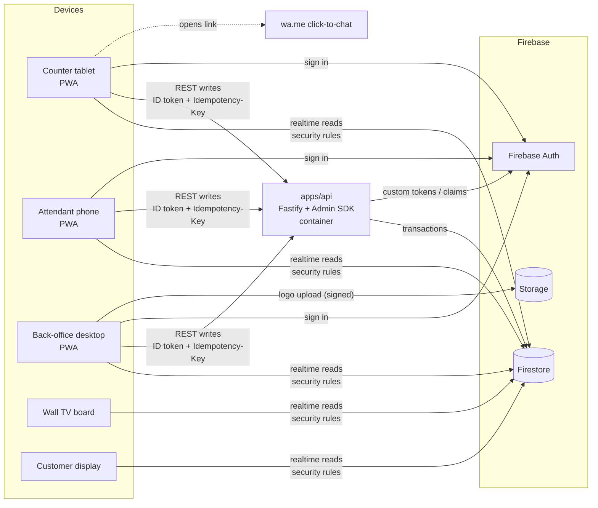
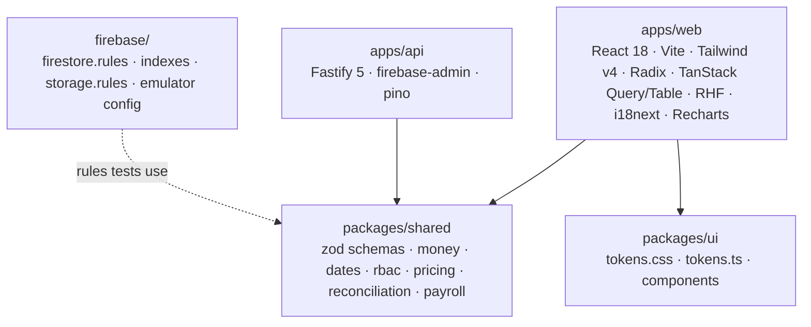
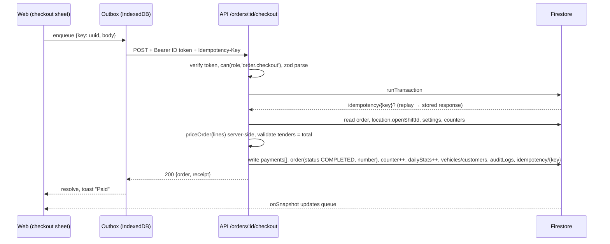
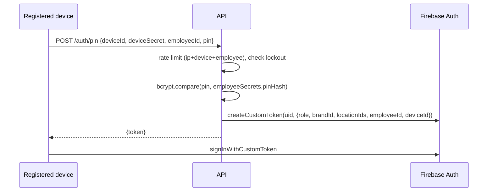

# Architecture

## System context

## Monorepo

`packages/shared` is pure TypeScript with no Firebase import, so the same functions run in the browser, in Node and in tests.

## Write path (example: checkout)

Rules for the API:
1. Each route declares `permission`, `body` (zod), `idempotent: true|false`.
2. The handler runs in one `db.runTransaction`. All reads come before writes (a Firestore requirement).
3. `audit(tx, {...})` is called inside the same transaction.
4. Money is computed only with `@stopwash/shared/money`.
5. Errors are mapped to `{ error: { code, message, details } }` with HTTP status. Codes are stable strings (`SHIFT_NOT_OPEN`, `VARIANCE_EXPLANATION_REQUIRED`, …) and are translated on the client.

## Read path
- Web uses Firestore `onSnapshot` through small hooks (`useLiveQuery`) that always add `where('brandId','==',claims.brandId)`.
- TanStack Query caches API GETs (previews, lookups, reports).
- Persistent local cache: `initializeFirestore(app, { localCache: persistentLocalCache({ tabManager: persistentMultipleTabManager() }) })`.

## Auth

Email users sign in with Firebase email/password, and custom claims are set by the API admin endpoint. Every API request carries the Firebase ID token, which the API verifies with `verifyIdToken(token, true)` (revocation check).

Manager override (variance > override threshold, big discount, cash-out approval, handover): the client sends `{overrideEmployeeId, overridePin}` with the request. The API verifies it in the same request, so no long-lived elevated session exists.

## Offline
- Reads: Firestore persistent cache. The queue and catalog keep working offline.
- Writes: `apps/web/src/lib/outbox.ts` holds pending requests in IndexedDB keyed by idempotency key, retries with backoff when `navigator.onLine` and on `online` events, and shows a global banner. Orders created offline appear in the queue with a "pending sync" badge (merged from the outbox).
- A service worker (vite-plugin-pwa, Workbox) precaches the app shell and fonts.

## Environments
| Env | Firebase | API |
|---|---|---|
| dev | Emulator Suite in Docker, project `demo-stopwash` | `pnpm --filter api dev` on :8080 |
| test/CI | Emulators (Docker) | in-process Fastify `inject()` |
| prod | real project (to be created) | container (Cloud Run suggested) |

## Security layers
1. Firestore rules: brand/location scoping, role checks, append-only collections, field-level checks on the few client writes.
2. API: token verification, RBAC, zod validation, rate limiting (`@fastify/rate-limit`), helmet headers, CORS allow-list, request size limits, idempotency.
3. Secrets: only through env (`.env`, never committed). The service account is used in prod only; emulators need none.

## Conventions

- Money is integer LKR cents. Times are stored in UTC, and business days are Asia/Colombo dates.
- Every record carries `brandId` and `locationId`. Writes take an `Idempotency-Key`.
- Financial records are append-only. Corrections are reversing entries, and every change is audit-logged.
- One conventional commit per change. Never commit `.env` files or keys.
